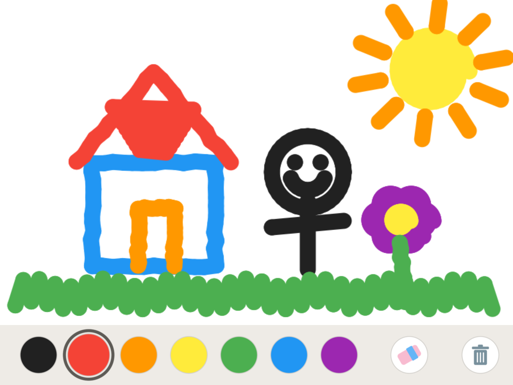
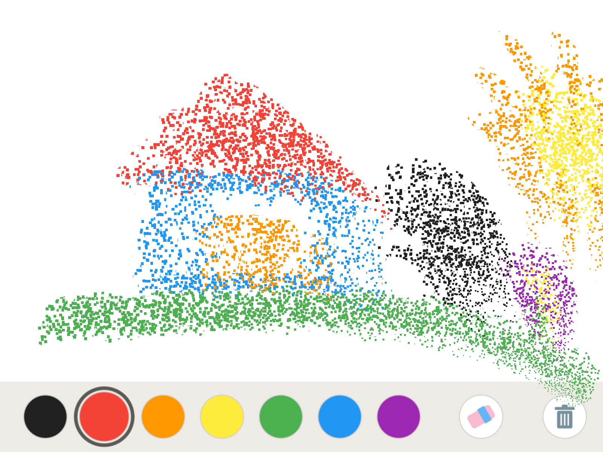

# KidsDrawing

子ども用お絵描きアプリ（iPad / Unity）。

**「指でぐりぐり描く。それだけで楽しい。」** 2歳の子が説明なしで使えるよう、画面には色と道具のボタンだけを置いています。

| 描いているところ | 全部消し：絵が粒になって吸い込まれる |
|---|---|
|  |  |

## できること

- **指で描く**：触れた瞬間に色が出ます。指を速く動かしても線は途切れません。描くのは最初に触れた1本の指だけです。
- **7色のパレットと消しゴム**：選んでいるボタンは大きくなり、輪で囲まれます。色を選ぶとペンに戻ります。
- **全部消し**（右端のごみ箱）：消す前の絵を写真アプリに保存してから消します。消えるときは、絵が粒になってボタンに吸い込まれます。
- **自動保存**：描くのをやめて2秒たつか、アプリを閉じると保存されます。次に開くと前回の絵が戻ります。
- 文字、設定画面、広告、ネットワーク通信はありません。

## 対象環境

| | |
|---|---|
| 端末 | iPad Pro 9.7インチ（2016）、横向き固定 |
| OS | iPadOS 15.0 以上（実機は 16.7） |
| エンジン | Unity 6000.3.27f1（Built-in レンダーパイプライン、Metal） |
| ビルド | Xcode 27 |

## ビルドとインストール

1. Apple Developer の Team ID を `scripts/local.env` に書きます。このファイルは git の管理対象外です。

   ```sh
   echo 'APPLE_TEAM_ID=XXXXXXXXXX' > scripts/local.env
   ```

2. ビルドします。Unity での書き出し、Xcode でのビルドと署名、.ipa の作成までを一度に行います。

   ```sh
   scripts/build-ios.sh
   ```

3. できた `KidsDrawing/Builds/KidsDrawing.ipa` を iPad に入れます。
   - Mac の Finder で iPad を選び、「一般」タブに .ipa をドラッグ＆ドロップします。
   - Apple Configurator の「追加 → App」からも入れられます。
   - Xcode 27 は iPadOS 16 の実機を扱えないため、Xcode の Run からは転送できません。
   - iPad 側で「デベロッパモード」をオンにしておく必要があります（設定 → プライバシーとセキュリティ）。

Player Settings とメインシーンは `KidsDrawing/Assets/Scripts/Editor/ProjectSetup.cs` が作ります。設定を変えたいときはこのファイルを直して、Unity のメニュー **KidsDrawing → Apply Project Setup** を実行してください。

## 保護者の方へ：アプリから出られないようにする

4本・5本指のスワイプやピンチによるアプリ切り替えは iPadOS の機能なので、アプリ側では止められません。次のどちらかを設定してください。

- **アクセスガイド**（おすすめ）
  - 設定 → アクセシビリティ → アクセスガイド をオンにします。
  - アプリを開いてホームボタンを3回押すと開始します。開始中はアプリの外に出られません。
  - 終了するときも、ホームボタンを3回押してパスコードを入力します。
- **ジェスチャをオフ**
  - 設定 → ホーム画面とマルチタスク → ジェスチャ をオフにします。
  - 複数の指によるアプリ切り替えだけが止まります。

## しくみ

絵は線の座標としては持たず、1枚の RGBA 画像（RenderTexture、1024×648）として持ちます。透明な部分は「何も描かれていない」を意味し、白い背景は表示するときに重ねます。

| ファイル | 役割 |
|---|---|
| `CanvasData.cs` | 描画テクスチャとキャンバス領域。エフェクトからもここを参照する |
| `CanvasPainter.cs` | 線分を「カプセル」として GPU で描く。消しゴムはブレンド方式の違いだけで実現 |
| `InputController.cs` | 最初に触れた指を追い、線分を描かせる |
| `BrushController.cs` | 色・太さ・ペン／消しゴム |
| `DrawingUI.cs` | 下部ツールバー（図形はシェーダーで描画し、画像素材は使わない） |
| `DrawingPersistence.cs` | PNG での自動保存と復元（一時ファイルに書いてから置き換える） |
| `ArtworkArchiver.cs` | 全部消しの前に写真アプリへ保存する |
| `SuckInEffect.cs` | 絵を粒にして吸い込ませる演出（頂点シェーダーで計算） |

仕様は [Docs/concept/concept.md](Docs/concept/concept.md) にあります。
